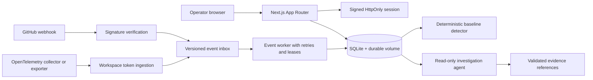

# ChangeGraph architecture

ChangeGraph is a workspace-scoped incident investigation application. The web application owns product state and authorization; providers contribute signed, versioned evidence events; the investigator only reads evidence and returns hypotheses.

## Runtime shape

## Trust boundaries

- Browser requests use a signed, expiring session cookie and server-side membership checks.
- JSON mutations apply same-origin validation when an Origin header is present and use database-backed rate-limit buckets for consistent single-host enforcement.
- GitHub events require `x-hub-signature-256` and an explicitly configured workspace binding.
- OpenTelemetry events require a workspace ingest token and an explicitly configured workspace binding.
- Every accepted event is persisted before processing, keyed by `(source, idempotency_key)`.
- Event processing uses a short-lived lease so a crashed worker can be reclaimed without concurrent double-processing.
- Failed events retry with backoff and move to `dead_letter_events` after the configured attempt ceiling.
- AI output is stored as an uncertain investigation. Evidence references are filtered against references returned by read-only tools.

## Deployment modes

### Local and portfolio demo

Use SQLite, the seeded Northstar demo workspace, and the local development email-link flow. The app is fully runnable without external services.

### Single persistent host

Use the provided Docker image and a durable volume mounted at `/app/data`. Run the web app and `npm run worker:events` as separate processes. This mode is appropriate for a controlled portfolio demo or internal preview.

### Multi-instance production

Move product data to PostgreSQL, telemetry references to a high-volume store, the in-process worker to a durable queue, and rate limits to a low-latency shared service. Add a real email provider and per-workspace provider credentials before onboarding real users. See [POSTGRES_MIGRATION.md](POSTGRES_MIGRATION.md) for the explicit migration boundary.

## Data flow

Provider or collector -> authenticated route -> `event_inbox` -> lease-based event worker -> workspace-scoped product records -> audit trail -> deterministic detector -> evidence-linked hypotheses -> optional read-only model investigation.

The detector can create an incident when multiple signals agree. Neither the detector nor the model agent is allowed to label a hypothesis as proven causality.
